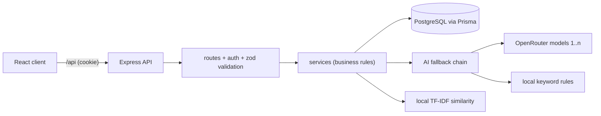
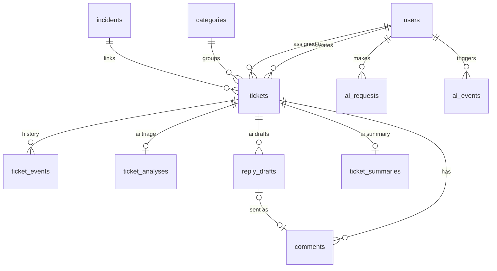

# Helpdesk

A support ticket system for small internet service providers and IT service shops in Bangladesh.

Small ISPs usually take complaints over the phone or Facebook. Complaints get lost, nobody knows who is handling what, urgent problems wait behind minor ones, and an area-wide outage is noticed only after dozens of calls. Helpdesk gives customers one place to report problems and gives the support team a queue with priorities, SLA due times, a clear workflow and an AI assistant that triages tickets, drafts replies and spots outages.

## Features

Customers

- Register with their area, open tickets in English, Banglish or Bangla, follow the conversation and history
- See similar problems that were already solved before submitting, and skip the ticket if one of them helps
- Get a warning when they are about to open a duplicate of their own open ticket
- Confirm a fix or reopen a ticket that is still not working

Agents

- Ticket queue with filters (status, priority, category, area, assignment, overdue) and search
- Workflow: start work, resolve with a resolution note, close, reopen
- AI triage on every new ticket (category, priority, sentiment, language, summary, reason) to accept or correct
- AI reply drafts in the customer's language, a conversation summary for long tickets, similar solved tickets
- SLA due times by priority with overdue marking

Admins

- Everything agents can do, plus assigning tickets to anyone and managing categories
- Outage suggestions when several customers in one area report similar connection problems, incidents that resolve all linked tickets at once
- AI usage page: model chain status, fallback rate, latency, acceptance and edit rates, offline evaluation results

## Tech stack

- Frontend: React 19, Vite, TypeScript, React Router, TanStack Query, Tailwind CSS 4, react-hook-form, zod
- Backend: Node.js 22, Express 5, TypeScript, Prisma 7, PostgreSQL 17, zod
- Auth: bcrypt password hashing, JWT in an httpOnly cookie, role based access
- AI: OpenRouter chat completions with an ordered model fallback chain, local keyword fallback, local TF-IDF similarity
- Tests: Vitest and Supertest against a separate test database
- Deployment: Vercel (client), Render (API), Neon (database)

## Architecture



The server follows a plain routes, controllers, services structure. Controllers only read the request and send the response, services hold the business rules and talk to Prisma directly. All AI code lives in `server/src/ai`.

```
helpdesk/
  client/src/        api/, components/, features/, hooks/, layouts/, lib/, pages/
  server/prisma/     schema and migrations
  server/scripts/    seed, demo data, outage simulation, demo cleanup
  server/src/        app, config, routes, controllers, services, schemas, middleware, ai/
  server/tests/      unit and integration tests
```

## Getting started

Requirements: Node.js 22.22 or newer, Docker.

```
git clone <repo-url> helpdesk
cd helpdesk
docker compose up -d                       # postgres for development (5434) and tests (5435)
cp server/.env.example server/.env
cp client/.env.example client/.env
npm install                                # installs both apps and generates the Prisma client
npm run db:migrate                         # creates the tables
npm run seed                               # ticket categories
npm run seed:demo                          # optional demo users and tickets
npm run dev                                # API on http://localhost:4000, app on http://localhost:5173
```

The app works without an OpenRouter key. All AI features then use the local fallback and are labeled "Local fallback" in the UI. To use real models, set `OPENROUTER_API_KEY` and `OPENROUTER_MODELS` in `server/.env` and restart the server.

### Choosing OpenRouter models

1. Create a free key at https://openrouter.ai/settings/keys
2. Open https://openrouter.ai/models, filter by "Free" and copy the ids of a few instruction-tuned models (they end with `:free`)
3. Put them in `OPENROUTER_MODELS`, comma separated, best model first

Free models change from time to time. If a model disappears, the chain skips it and the AI usage page shows `model_unavailable` for it.

### Environment variables

Server (`server/.env`)

| Variable                  | Description                                                    |
| ------------------------- | -------------------------------------------------------------- |
| `NODE_ENV`                | `development`, `test` or `production`                          |
| `PORT`                    | API port, default 4000                                         |
| `CLIENT_ORIGIN`           | Allowed CORS origin, the client URL                            |
| `DATABASE_URL`            | PostgreSQL connection string                                   |
| `TEST_DATABASE_URL`       | Database used by `npm test`, it is wiped by the tests          |
| `JWT_SECRET`              | Long random string, at least 16 characters                     |
| `JWT_EXPIRES_DAYS`        | Session length in days, default 7                              |
| `OPENROUTER_API_KEY`      | Optional, without it the local fallback is used                |
| `OPENROUTER_BASE_URL`     | Default `https://openrouter.ai/api/v1`                         |
| `OPENROUTER_MODELS`       | Comma separated model ids, tried in this order                 |
| `AI_TIMEOUT_MS`           | Timeout per model call, default 15000                          |
| `AI_DAILY_QUOTA_PER_USER` | Successful AI calls per user per day, default 50               |
| `OUTAGE_MIN_TICKETS`      | Different customers needed for an outage suggestion, default 5 |
| `OUTAGE_WINDOW_MINUTES`   | Time window for outage detection, default 30                   |

Client (`client/.env`)

| Variable                | Description                                                        |
| ----------------------- | ------------------------------------------------------------------ |
| `VITE_API_PROXY_TARGET` | Where the dev server sends `/api`, default `http://localhost:4000` |
| `VITE_SHOW_DEMO_LOGINS` | `true` shows quick login buttons for the demo accounts             |

## Demo accounts and data

After `npm run seed:demo` every account below uses the password `demo1234`.

| Role     | Email                                                                                                                                                              |
| -------- | ------------------------------------------------------------------------------------------------------------------------------------------------------------------ |
| Admin    | admin@demo.local                                                                                                                                                   |
| Agent    | rahim@demo.local, nadia@demo.local                                                                                                                                 |
| Customer | karim@demo.local, tania@demo.local (Mirpur), sumaiya@demo.local (Dhanmondi), arif@demo.local (Uttara), nusrat@demo.local (Gulshan), fahim@demo.local (Mohammadpur) |

Demo data includes about 50 tickets over the last 30 days in all statuses, conversations, AI analyses, reply drafts, summaries, a resolved incident and AI request history. Everything is flagged with `is_demo`.

| Command                                | What it does                                                                                                                                                           |
| -------------------------------------- | ---------------------------------------------------------------------------------------------------------------------------------------------------------------------- |
| `npm run seed:demo`                    | Creates the demo data. Running it again replaces the old demo data.                                                                                                    |
| `npm run demo:outage -- --area=Mirpur` | Creates a fresh burst of connection complaints from different customers in one area so the outage suggestion appears (the detector only looks at the last 30 minutes). |
| `npm run demo:clear`                   | Removes only demo rows in one transaction after a confirmation. Add `-- --yes` to skip the question.                                                                   |

## Scripts

| Command             | Description                                          |
| ------------------- | ---------------------------------------------------- |
| `npm run dev`       | Start API and client in watch mode                   |
| `npm run build`     | Build API and client                                 |
| `npm test`          | Run all server tests (needs the `db-test` container) |
| `npm run lint`      | ESLint for both apps                                 |
| `npm run typecheck` | TypeScript check for both apps                       |
| `npm run ai:eval`   | Run the AI evaluation, see below                     |

## Business rules

Status workflow

```
OPEN -> IN_PROGRESS -> RESOLVED -> CLOSED
            ^              |
            +---- reopen --+
```

- Staff can make any allowed transition. Customers can only close a resolved ticket or reopen it.
- Resolving needs a resolution note. It is shown to the customer and used to suggest fixes for similar tickets.
- An agent who starts work on an unassigned ticket is assigned to it.
- Invalid transitions return 409. Every change is written to the ticket history.

SLA

- Due time from creation: Urgent 4 hours, High 24 hours, Medium 48 hours, Low 72 hours.
- Changing the priority recalculates the due time from the original creation time.
- Open and in progress tickets past their due time are overdue. Resolved and closed tickets are never overdue.

Visibility

- Customers see only their own tickets, agents see tickets assigned to them and unassigned tickets, admins see everything.
- A ticket the user cannot see returns 404, so its existence is not revealed.

Incidents

- An outage suggestion appears when at least `OUTAGE_MIN_TICKETS` different customers in the same area open similar Connectivity tickets within `OUTAGE_WINDOW_MINUTES`.
- An admin turns the suggestion into an incident. Resolving the incident resolves every linked open ticket with the same note, adds a message for each customer and a history entry, all in one transaction.

## AI feature: Triage Copilot

### What it does

| Feature                        | Input                                                       | Output                                                                      |
| ------------------------------ | ----------------------------------------------------------- | --------------------------------------------------------------------------- |
| Ticket triage                  | ticket title and description (English, Banglish or Bangla)  | category, priority, sentiment, language, one sentence summary, short reason |
| Reply drafts                   | ticket, last 10 comments, fixes from similar solved tickets | a reply in the customer's language for the agent to edit and send           |
| Thread summary                 | conversations with 6 or more comments                       | issue, what was tried, current state, next step                             |
| Incident summary               | the reports linked to an incident                           | incident title and summary                                                  |
| Similar tickets (local)        | new ticket text                                             | 3 most similar solved tickets with their fixes, duplicate warning           |
| Outage detection (local rules) | recent Connectivity tickets per area                        | outage suggestion                                                           |

Triage runs in the background after a ticket is saved, so the customer never waits for a model. The suggested category and priority fill the ticket until an agent accepts or changes them. Replies are never sent by the AI.

### Model fallback chain

Every AI request goes through `server/src/ai/chain.ts`:

1. Return the cached answer if the same request was answered in the last hour.
2. Try each model from `OPENROUTER_MODELS` in order, skipping models that are cooling down.
3. Valid JSON that matches the zod schema is returned. Categories and priorities must be known values.
4. 429 rate limit: the model cools down (Retry-After or 60 seconds) and the next model is tried.
5. Server error, timeout or network error: one retry, then the next model.
6. Invalid JSON or wrong shape: next model. Model removed (404): cooldown for 10 minutes.
7. Invalid key (401): the chain stops, the other models would fail the same way.
8. Nothing worked, no key, or the user reached the daily quota: local fallback, labeled in the UI.

Every attempt is logged in `ai_requests` and shown on the AI usage page.

### Safety

- Phone numbers and email addresses are masked before text leaves the server.
- Ticket text is sent inside clear tags and the system prompt says to treat it as data only. The output must match a strict schema, and the AI cannot take actions by itself. The evaluation set contains a prompt injection attempt.
- Priority safety rules for critical phrases ("whole office", "money deducted", "taka kete", "net nai") can raise the priority but never lower it, because missing an urgent ticket costs more than over-prioritizing a small one.
- Per-user rate limit on AI endpoints and a daily quota.

### How usefulness is measured

Offline: `npm run ai:eval` runs 147 labeled tickets (85 English, 40 Banglish, 22 Bangla, written for this project) through a majority-class baseline, the local fallback and every configured model separately, with the same prompt and safety rules as production. It reports category accuracy, macro F1, per-class precision and recall, a confusion matrix, priority accuracy, the under-triage rate (urgent or high tickets predicted as medium or low), valid JSON rate and latency, and evaluates outage detection on 40 simulated bursts. The report is saved to `server/src/ai/reports/latest.json` and shown on the AI usage page.

Current results without an API key:

| Approach               | Category accuracy | Macro F1 | Priority accuracy | Under-triage |
| ---------------------- | ----------------- | -------- | ----------------- | ------------ |
| Majority baseline      | 22.4%             | 6.1%     | 43.5%             | 100%         |
| Local keyword fallback | 81.0%             | 81.4%    | 39.5%             | 53.8%        |

Local fallback category accuracy by language: English 77.6%, Banglish 87.5%, Bangla 81.8%. Outage detection: precision 100%, recall 90% on simulated bursts.

The local fallback is good at categories but weak at priority, which is why the model chain is the main path. Run `npm run ai:eval` with your key to add each model to the table. A test (`server/tests/evaluation.test.ts`) fails if the local fallback stops clearly beating the baseline.

Online: the AI usage page tracks the share of triage suggestions accepted unchanged, overrides per category, reply draft ratings, how much agents edit drafts before sending (word level edit distance), tickets avoided because a similar fix helped, and duplicate warnings.

### Limitations

- Ticket text is sent to a third party. Masking lowers the privacy risk but does not remove it.
- OpenRouter's free tier has a daily request limit shared by all free models. When it runs out, every model fails and the local fallback answers.
- Model output is not fully deterministic even at temperature 0, and free models can be removed.
- Prompt injection is reduced, not eliminated, which is why staff confirm every suggestion.
- The local fallback is much weaker than a model, especially for priority.
- The labeled set is small and written by the same person who wrote the keyword lists, so the local fallback numbers are likely optimistic.
- Similarity is word based, so the same problem described with different words may not match.
- Cooldowns and the cache live in memory and reset when the server restarts. Background triage runs in the server process, so an analysis cut off by a restart is marked failed and can be run again.

## Database



- Deleting a ticket deletes its comments, history, analysis, drafts and summary.
- Deleting a staff member keeps their tickets and sets the assignee to null.
- Deleting an incident or a category keeps the tickets.
- `tickets.area` copies the customer's area at creation, so outage queries do not need a join and old tickets keep the right area.

## API overview

All endpoints are under `/api`. Errors use one shape: `{ "error": { "message": "...", "details": { "field": ["message"] } } }` with status 400, 401, 403, 404, 409, 429 or 500.

| Area          | Endpoints                                                                                                                                                                                                                 |
| ------------- | ------------------------------------------------------------------------------------------------------------------------------------------------------------------------------------------------------------------------- |
| Auth          | `POST /auth/register`, `POST /auth/login`, `POST /auth/logout`, `GET /auth/me`                                                                                                                                            |
| Tickets       | `GET /tickets`, `POST /tickets`, `GET /tickets/:id`, `PATCH /tickets/:id`, `DELETE /tickets/:id`                                                                                                                          |
| Workflow      | `POST /tickets/:id/status`, `POST /tickets/:id/assign`                                                                                                                                                                    |
| Comments      | `GET /tickets/:id/comments`, `POST /tickets/:id/comments`                                                                                                                                                                 |
| AI on tickets | `GET /tickets/:id/analysis`, `POST /tickets/:id/analysis/review`, `POST /tickets/:id/analysis/retry`, `POST /tickets/:id/reply-drafts`, `PATCH /reply-drafts/:id`, `GET /tickets/:id/summary`, `GET /tickets/:id/similar` |
| AI            | `POST /ai/triage-preview`, `POST /ai/similar`, `POST /ai/deflections`, `GET /ai/usage`                                                                                                                                    |
| Incidents     | `GET /incidents`, `GET /incidents/suggestions`, `GET /incidents/:id`, `POST /incidents`, `POST /incidents/:id/tickets`, `POST /incidents/:id/resolve`                                                                     |
| Other         | `GET /stats`, `GET/POST/PATCH/DELETE /categories`, `GET /users`, `GET /health`                                                                                                                                            |

## Testing

```
docker compose up -d
npm test
```

The tests run against the `db-test` container and never call OpenRouter (the chain is tested with a fake provider and the client with a mocked `fetch`). They cover:

- auth: registration, validation errors, role cannot be chosen, duplicate email, wrong password, missing or tampered token
- tickets: SLA calculation, status transitions and permissions, visibility rules, filters, resolution notes, assignment rules
- AI chain: rate limit and cooldown, invalid JSON, timeout retry, invalid key, all models failing, quota, cache
- AI features: background triage, review, retry, similar tickets with masking, duplicates, deflections, reply drafts with edit ratio, summaries, usage page
- incidents: outage detection thresholds, creating, linking and resolving with all tickets updated
- evaluation quality gate

## Deployment

API on Render

1. Create a PostgreSQL database on Neon and copy its connection string.
2. Create a Render web service from this repository (or use `render.yaml`). Build command: `npm ci && npm run build -w server && npm run db:deploy -w server && npm run seed -w server`. Start command: `npm run start -w server`.
3. Set `DATABASE_URL`, `JWT_SECRET`, `CLIENT_ORIGIN` (the Vercel URL), `NODE_ENV=production` and optionally the OpenRouter variables.

Client on Vercel

1. Import the repository with `client` as the root directory.
2. Change the API address in `client/vercel.json` to your Render URL. Vercel forwards `/api` to Render, so the auth cookie stays on the same site and works with `SameSite=Lax`.

Demo data can be loaded on the deployed database by running `npm run seed:demo` locally with `DATABASE_URL` pointing to Neon.

## Known limitations and possible improvements

- Background AI work runs inside the API process. A job queue (for example BullMQ with Redis) would survive restarts and scale to several instances.
- The AI cache and model cooldowns are in memory; several API instances would need a shared store.
- No email or SMS notifications yet; customers see updates when they open the app.
- No file attachments on tickets.
- Similar ticket search compares up to 500 recent solved tickets in memory, which is fine for a small ISP but would need a search index for larger volumes.
- The local fallback and the labeled set only cover the six default categories.
- Free OpenRouter models can be slow (several seconds) and are rate limited.
